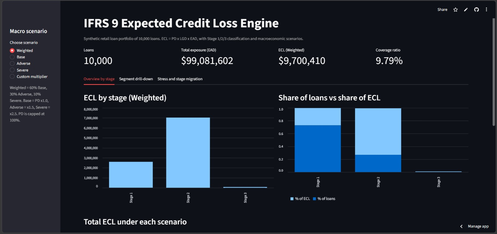
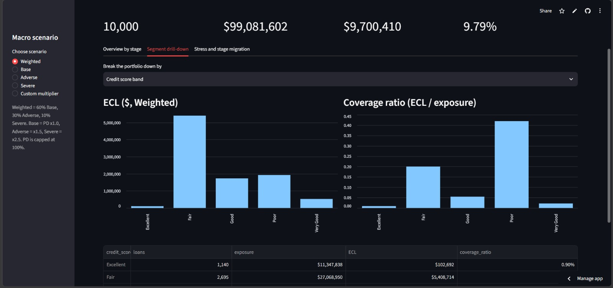
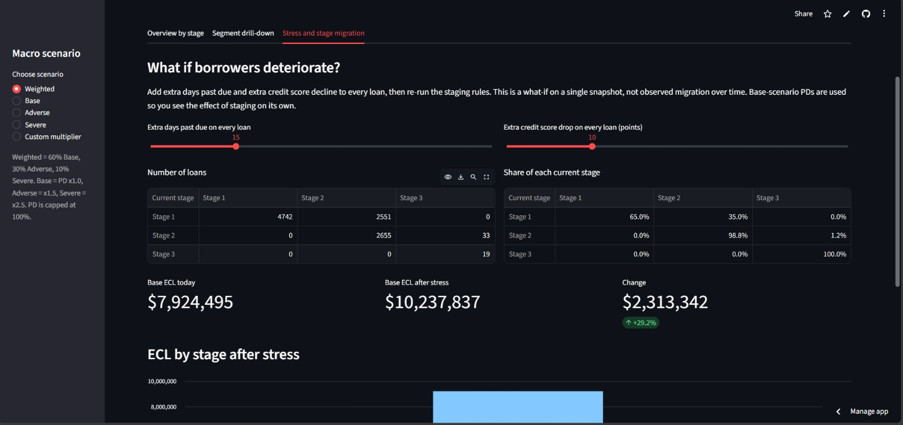
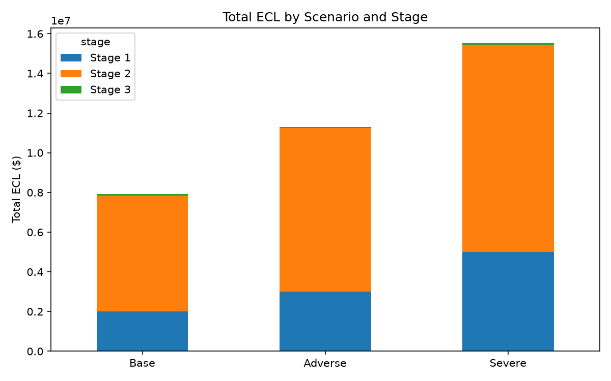

# IFRS 9 Expected Credit Loss (ECL) Engine

**Live demo:** https://sarthak-ifrs9-ecl-engine.streamlit.app/

An end-to-end Python implementation of the IFRS 9 impairment model on a 10,000-loan synthetic retail portfolio. It estimates PD, LGD and EAD per loan, classifies every loan into Stage 1/2/3, calculates 12-month and lifetime ECL, applies probability-weighted macroeconomic scenarios, and presents the results in an interactive dashboard.



## The problem

Under the old accounting rule (IAS 39), banks recognised a loss only after a loan had already gone bad, which was "too little, too late" in the 2008 crisis. IFRS 9 requires banks to provision for **expected** losses from day one and to increase the provision as credit risk rises. This project builds the calculation a bank risk team runs to do that.

```
ECL = PD x LGD x EAD
```

- **PD**: probability of default
- **LGD**: share of the exposure lost if default happens
- **EAD**: amount outstanding at the moment of default

## Headline results

| Scenario | Total ECL | Coverage ratio |
|---|---|---|
| Base (PD x1.0) | $7.92M | 8.00% |
| Adverse (PD x1.5) | $11.31M | 11.42% |
| Severe (PD x2.5) | $15.53M | 15.67% |
| **Probability-weighted (60/30/10)** | **$9.70M** | **9.79%** |

| Stage | Loans | Base ECL |
|---|---|---|
| Stage 1 (performing) | 7,293 | $2.00M |
| Stage 2 (significant increase in credit risk) | 2,688 | $5.85M |
| Stage 3 (credit-impaired) | 19 | $0.07M |

Total exposure is about $99M. Stage 2 holds about 74% of Base ECL, so the loans that are on a watch list, not the defaulted ones, drive most of the loss estimate and most of the stress sensitivity.

Severe ECL is about 1.96x Base rather than 2.5x because PD is capped at 100%, and Stage 2 and Stage 3 loans are already close to that cap.

## Methodology

1. **Synthetic data:** real bank loan tapes are not public, so a 10,000-loan portfolio is generated with deliberately correlated risk fields (origination score, current score, days past due, watchlist flag, balances, revolving limits). The generator was recalibrated after validation showed no Stage 3 loans and an unrealistic share in Stage 2.
2. **PD model:** logistic regression on 19 features with standard scaling and an 80/20 stratified split. `class_weight='balanced'` was removed because it inflated predicted probabilities (Stage 1 PD averaged 32%). That does not matter for ranking but breaks ECL, which uses the probability itself. Bucketed duplicates of continuous features were also dropped to avoid multicollinearity. On the 20% held-out test set the model scores AUC-ROC 0.782, KS 0.435 and Gini 0.564 (Gini = 2 x AUC - 1). These are flattered by the delinquency leakage described under Limitations.
3. **LGD:** segment-based recovery assumptions by loan purpose (auto 70%, home improvement 55%, debt consolidation 35%, personal 30%), adjusted slightly for balance size.
4. **EAD:** current balance for term loans. For revolving loans, current balance plus 50% of the undrawn limit (credit conversion factor 0.50).
5. **Staging:** Stage 3 if days past due is 90 or more. Stage 2 if days past due is 30 or more, credit score has fallen 30 or more points since origination, or the loan is on the watchlist. Otherwise Stage 1. Rules are evaluated worst-first. See `docs/staging_logic.md`.
6. **ECL:** Stage 1 uses 12-month PD. Stage 2 and 3 use lifetime PD, derived as `1 - (1 - PD)^n` with n = remaining years (5-year term assumed).
7. **Macro overlay:** Base, Adverse and Severe PD multipliers (1.0, 1.5, 2.5), capped at 100%, blended with 60/30/10 probability weights.
8. **Sensitivity and tests:** ECL is flexed against the PD multiplier, LGD and scenario weights (`notebooks/11_sensitivity_analysis.ipynb`). Core logic is in `src/` with 18 pytest unit tests, including the 29/30/89/90 days-past-due boundaries.

## Dashboard

| Segment drill-down | Stress and stage migration |
|---|---|
|  |  |

- Scenario selector (Base, Adverse, Severe, Weighted, or a custom PD multiplier) that recalculates every chart.
- Breakdown by loan type, purpose, region and credit score band.
- A what-if view that adds extra delinquency and score decline, re-runs the real staging rules, and shows the resulting stage-migration matrix and ECL change.



## Repository structure

```
ifrs9-ecl-engine/
├── notebooks/        01 data generation -> 11 sensitivity analysis
├── src/              staging.py, ecl_engine.py, saved PD model and scaler
├── tests/            pytest unit tests
├── dashboard/        Streamlit app
├── data/processed/   cleaned data and ECL outputs
├── docs/             staging rules, charts, screenshots
├── requirements.txt          dashboard dependencies
└── requirements-dev.txt      notebook and test dependencies
```

## Run it locally

```bash
git clone https://github.com/Sarthak7209/ifrs9-ecl-engine.git
cd ifrs9-ecl-engine
python -m venv venv
source venv/Scripts/activate        # Windows Git Bash; on Mac/Linux use venv/bin/activate
pip install -r requirements.txt -r requirements-dev.txt
pytest -v
streamlit run dashboard/app.py
```

Run the notebooks in numeric order to regenerate every output.

## Limitations

- **The data is synthetic.** Results show that the pipeline works, not how a real portfolio behaves.
- **Target leakage:** days past due is mechanically linked to the default flag in the generator, so the PD model's apparent skill is overstated. A production model would exclude or lag delinquency features.
- **LGD** uses assumed recovery rates because there is no recovery history. A real model would be estimated on observed recoveries.
- **Staging** uses rule-based triggers. Real banks also compare lifetime PD today with lifetime PD at origination.
- **Lifetime PD** assumes a 5-year term and independent annual default risk, rather than a term structure.
- **Scenario multipliers and weights** are illustrative. Real banks derive them from macroeconomic models, for example default rates regressed on unemployment.
- Stage migration in the dashboard is a stress-based what-if on one snapshot, not observed movement over time.

## License

MIT